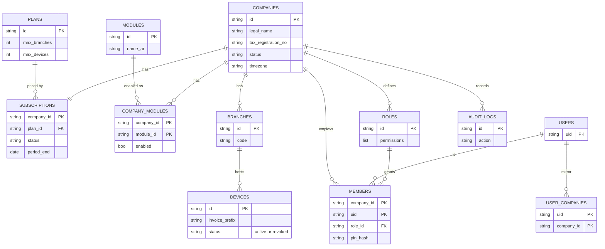
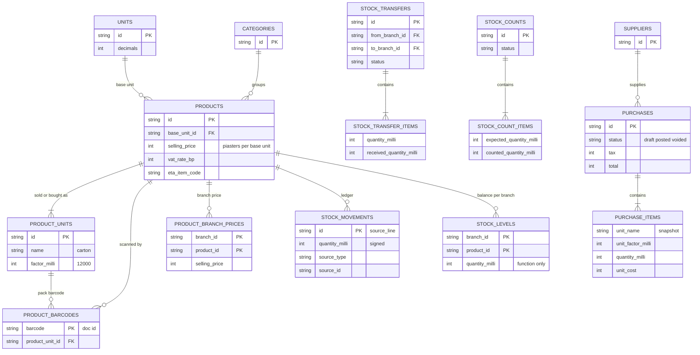
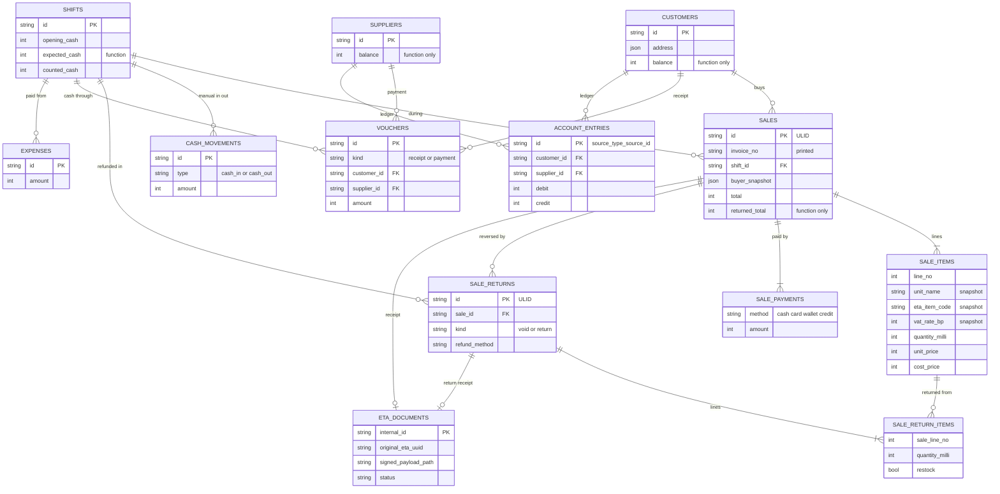

# خطة قاعدة البيانات متعددة الشركات (Multi-tenant) — Tashil ERP

> الحالة: مقترح للمراجعة · التاريخ: 2026-11-25 · المراجعة الثانية: 2026-11-26 (القسم 9)
> الملفات المرتبطة: [`sync-strategy.md`](./sync-strategy.md) (استراتيجية المزامنة) · [`tashil-erp.dbml`](./tashil-erp.dbml) (مخطط ER كامل، يتفتح في [dbdiagram.io](https://dbdiagram.io) من Import > DBML)

## 0. الخلاصة في سطور

| السؤال | القرار المقترح |
|---|---|
| الداتا هتتخزن فين على السحابة؟ | **Cloud Firestore (Native mode)** في مشروع Firebase واحد للإنتاج |
| "قاعدة بيانات لكل تاجر" هتتعمل إزاي؟ | كل شركة ليها **مساحة معزولة منطقيًا** تحت المسار `/companies/{companyId}/…`، والـ 11 سيستم بيقروا ويكتبوا في نفس المساحة دي |
| العزل والأمان؟ | Firebase Auth + **Custom Claims** (`cid`, `role`, `mods`) + **Security Rules** بتمنع أي حد يقرا خارج شركته |
| الصلاحيات؟ | Roles لكل شركة (owner / manager / cashier / storekeeper / accountant / custom) فيها permissions بصيغة `module.action` |
| تفعيل 5 أو 6 سيستمات بس؟ | جدول `company_modules` + الـ claim `mods`، والـ Rules والتطبيق والداشبورد بيقفلوا أي موديول مش مفعّل |
| على الجهاز؟ | Drift/SQLite زي ما هو، **ملف قاعدة بيانات منفصل لكل شركة** على الجهاز، وSyncOutbox بيرفع لـ Firestore |
| التقارير الكبيرة؟ | Cloud Functions بتعمل `daily_summaries`، وبعدين تصدير لـ **BigQuery** للتحليلات الثقيلة |
| الفلوس والكميات؟ | الفلوس integer بالقرش، والكميات integer (الكمية × 1000) بالوحدة الأساسية، مع وحدات تحويل لكل منتج (كرتونة = 12) |
| المستندات المالية؟ | ثابتة (create فقط)، والإلغاء والمرتجع مستند جديد. رقم المستند في الفايرستور هو مفتاح منع التكرار |
| قاعدة منفصلة فعليًا لتاجر معيّن؟ | متاحة كـ "Enterprise tier": Firestore بيسمح بقواعد متعددة في نفس المشروع (حد 100 لكل مشروع)، ونفس الكود يشتغل عليها لأن المسارات واحدة |

**ليه مش Postgres (Cloud SQL / Firebase SQL Connect / Supabase)؟** لأن أهم متطلب عندنا هو **Offline-first على SUNMI**، وFirestore هو الوحيد في منظومة Google اللي فيه offline قراءة وكتابة جاهز ومُدار بالكامل، وبيتوسع لوحده ويبدأ مجاني. Postgres أقوى في التقارير والـ joins، وده بنعوّضه بـ BigQuery. التفاصيل في القسم 2.

---

## 1. المتطلبات اللي الخطة مبنية عليها

1. السوبر أدمن (فريق Tashil) يكريت **شركة**، والشركة يتفتح لها مساحة بيانات واحدة مشتركة بين الـ 11 سيستم: Core، Products، Inventory، Receiving، POS، Reports، Customers & Suppliers، Sync & Admin، Cash drawer & Shifts، Credit accounts، Expenses، ETA e-invoice.
2. الشركة ممكن تاخد كل السيستمات أو جزء منها (مثلا 5 أو 6).
3. جوه الشركة فيه أدمن الشركة (owner) ومستخدمين بأنواع وصلاحيات مختلفة، ومحتمل فروع وأجهزة POS متعددة.
4. البيع لازم يشتغل من غير إنترنت على SUNMI V3، والمزامنة تحصل في الخلفية.
5. الفلوس integer بالقروش، والفواتير والحركات مبتتمسحش (cancel + حركة عكسية).
6. تفضيل منظومة Google/Firebase.

---

## 2. مقارنة الخيارات (Deep research)

### 2.1 أشكال الـ multi-tenancy الممكنة

| الشكل | إزاي | مميزات | عيوب | مناسب لينا؟ |
|---|---|---|---|---|
| **A. مساحة لكل شركة داخل قاعدة واحدة** (`/companies/{cid}/...`) | كل البيانات تحت مسار الشركة | أبسط تشغيل، deploy واحد للـ Rules والـ Indexes، مجاني في البداية (قاعدة واحدة بس مجانية لكل مشروع)، مفيش حد لعدد الشركات | العزل منطقي (بالـ Rules) مش فيزيائي | ✅ **الاختيار الافتراضي** |
| **B. قاعدة Firestore منفصلة لكل شركة** (named databases) | `firestore.database('tenant-x')` | عزل فيزيائي، backup/restore وحذف لكل شركة لوحدها | الحد **100 قاعدة لكل مشروع** (ممكن تطلب زيادة من الدعم)، القاعدة المجانية واحدة بس والباقي بفلوس، لازم تعمل deploy للـ Rules والـ Indexes لكل قاعدة، الـ Functions triggers لازم تتسجل لكل قاعدة | ⚠️ للتجار الكبار بس (Enterprise) |
| **C. مشروع Firebase لكل شركة** | مشروع كامل لكل تاجر | أقصى عزل وفصل فواتير | تشغيل مرهق جدًا (apps, keys, deploys, monitoring لكل مشروع)، صعب الداشبورد المركزي | ❌ |
| **D. Postgres + Row Level Security** | جدول واحد فيه `company_id` و RLS policy | SQL كامل، joins، تقارير، constraints | محتاج sync engine بنفسك للـ offline، سيرفر شغال 24 ساعة | ❌ كأساس، ✅ كـ analytics لاحقًا |

### 2.2 مقارنة المنتجات

| | **Cloud Firestore** | **Firebase SQL Connect** (اسمه القديم Data Connect) / Cloud SQL Postgres | **Supabase** (Postgres + RLS) |
|---|---|---|---|
| تبع Google؟ | ✅ | ✅ | ❌ |
| Offline على الموبايل | **قراءة وكتابة مدمجين** (مفعّل افتراضيًا على Android) | **Query cache اختياري** للقراءة بس | مش مدمج، محتاج PowerSync أو حل خاص |
| مع Drift + SyncOutbox بتاعنا | ممتاز: الـ outbox يكتب documents بنفس الـ `localUuid` (idempotent) | محتاج API mutations لكل جدول وحل تعارضات بإيدك | نفس الكلام |
| عزل الشركات | Security Rules + custom claims | `@auth` في الـ GraphQL operations أو RLS في Postgres | RLS قوي جدًا |
| تقارير و joins | ضعيف، بنعوّضه بـ summaries + BigQuery | ممتاز | ممتاز |
| التكلفة في البداية | Free tier يومي (قاعدة واحدة مجانية)، ادفع حسب الاستخدام | Cloud SQL instance شغال باستمرار حتى لو مفيش استخدام | Free tier ثم اشتراك شهري |
| التوسع | تلقائي بالكامل | محتاج تكبير الـ instance | حسب الخطة |
| Realtime للداشبورد | مدمج | محدود | مدمج |

**النتيجة:** Firestore بشكل **A** هو الأنسب للـ POS اللي شغال offline، ومعاه:
- **Cloud Functions** للعمليات الحساسة والمحسوبة (رصيد المخزون في السحابة، أرصدة العملاء، ترقيم ETA، الإرسال لمصلحة الضرائب).
- **BigQuery** (عن طريق إضافة Firestore → BigQuery export) للتقارير الثقيلة والتحليلات عبر سنين.
- **Cloud Storage** للمرفقات (صور المنتجات، إيصالات المصروفات) بمسار `companies/{cid}/...` وRules بنفس المنطق.
- **Secret Manager** لمفاتيح ETA لكل شركة. ممنوع تتخزن في Firestore أو في الريبو.

### 2.3 الهوية: Firebase Auth عادي ولا Identity Platform multi-tenancy؟

Identity Platform فيه "tenants" بمعنى **مجموعات مستخدمين منفصلة**، كل tenant ليه users وطرق دخول خاصة بيه. ده مفيد لما كل عميل عنده SSO خاص (SAML/OIDC)، لكنه:
- محتاج upgrade لـ Identity Platform وبيمنع نفس الشخص يبقى عضو في شركتين بنفس الحساب.
- مش ضروري لينا دلوقتي.

**القرار:** Firebase Auth عادي (هو أصلًا Identity Platform تحت) + **Custom Claims** للشركة والدور. الـ claims حدها **1000 byte**، فبنحط فيها الحاجات الصغيرة بس:

```json
{ "cid": "acme", "role": "cashier", "bids": ["b1"], "mods": ["pos","products","inventory","cash_shifts","parties"], "pv": 7 }
```

- `pv` = permissions version: لما الأدمن يغيّر صلاحية، الـ Function تزوّد الرقم ويتعمل refresh للتوكن.
- السوبر أدمن: `{ "sa": true }`.
- المستخدم اللي شغال في أكتر من شركة: الـ claims بتحمل **الشركة النشطة** بس، والتبديل بيتم بـ callable function `switchCompany(cid)` بعد التأكد من العضوية.

### 2.4 دخول جهاز الـ POS والكاشير

- **الجهاز نفسه** بيتسجل مرة واحدة (Sync & Admin): الأدمن يطلع QR/كود تفعيل من الداشبورد، الجهاز يبعته لـ function `activateDevice`، والـ function ترجّع **custom token** لحساب `device_<id>` فيه claims `{cid, bid, did}`. ده اللي بيعمل sync.
- **الكاشير** بيدخل على الجهاز بـ **PIN** (الـ hash بتاعه متزامن في `members.pin_hash`)، فالتبديل بين الكاشيرات يشتغل offline، وكل فاتورة متسجل عليها `cashier_uid`.
- لو الجهاز اتسرق: الأدمن يعمل revoke، والـ function تعمل 3 حاجات: `devices.status = revoked`، وتقفل حساب `device_<id>` في Auth، وتلغي الـ refresh tokens. والـ Rules بتراجع `status` مع كل كتابة من جهاز (`deviceOk`)، فالجهاز بيتقفل فورًا حتى لو التوكن بتاعه لسه صالح لمدة ساعة.
- الحقل `status` بتكتبه الـ function بس، والجهاز ميقدرش يغيّره.

---

## 3. هيكل البيانات في Firestore

```
/platform/modules/{moduleId}           ← كتالوج الـ 11 موديول (للسوبر أدمن)
/platform/plans/{planId}
/platformAdmins/{uid}
/users/{uid}                            ← بروفايل عام للشخص
  /companies/{cid}                      ← نسخة من العضوية عشان "شركاتي" تبقى query واحدة (Functions بس)

/companies/{cid}                        ← بيانات الشركة + status + timezone
  /subscription/current                 ← الباقة والحدود
  /modules/{moduleId}                   ← enabled, expiresAt, settings
  /branches/{branchId}
  /roles/{roleId}                       ← permissions: ["pos.sell","pos.refund",...]
  /members/{uid}                        ← roleId, branchIds, pinHash, status
  /devices/{deviceId}                   ← invoicePrefix, status, syncCursors
  /counters/{key}
  /auditLogs/{id}

  /categories/{id}  /units/{id}  /products/{id} (units[] جواه)                 ← Products
  /productBarcodes/{barcode}  /productBranchPrices/{branchId_productId_unitId}
  /stockMovements/{sourceType_sourceId_lineNo}  /stockLevels/{branchId_productId} ← Inventory
  /stockTransfers/{id} (items[] جواه)  /stockCounts/{id}/items/{productId}
  /customers/{id}  /suppliers/{id}                                            ← Customers & Suppliers
  /purchases/{id}/items/{lineNo}                                              ← Receiving
  /sales/{ulid} (items[] + payments[] جواه)                                   ← POS
  /saleReturns/{ulid} (items[] جواه)  /documentNumbers/{invoiceNo}
  /shifts/{id}  /cashMovements/{id}                                           ← Cash drawer & Shifts
  /vouchers/{id}  /accountEntries/{sourceType_sourceId}                       ← Credit accounts
  /expenseCategories/{id}  /expenses/{id}                                     ← Expenses
  /eta/settings  /etaDocuments/{internalId}                                   ← ETA e-invoice
  /dailySummaries/{branchId_yyyyMMdd}                                         ← Reports
```

> الـ DBML فيه 44 جدول منطقي. الجداول اللي مكتوب عليها embedded (زي `sale_items` و`sale_payments` و`product_units`) متخزنة كـ array جوه المستند الأب، فعدد الـ collections الفعلي أقل.

### 3.1 المفاتيح ومنع التكرار (idempotency)

الفايرستور **ملوش قيد UNIQUE**، فالحاجة اللي لازم تبقى فريدة لازم تبقى هي نفسها **رقم المستند**:

| المستند | رقم المستند (document id) | ليه |
|---|---|---|
| أي مستند بيعمله الجهاز (فاتورة، مرتجع، وردية، سند، مصروف…) | ULID بيتولّد مرة واحدة على الجهاز وقت الـ commit | إعادة الرفع بعد ما النت يقطع بتلاقي نفس المستند |
| رقم الفاتورة أو المرتجع المطبوع | `documentNumbers/{invoiceNo}` | بيتحجز في نفس transaction الرفع، والعداد بتاع الجهاز مبيرجعش لصفر |
| الباركود | الباركود نفسه | الباركود مستحيل يبقى على منتجين |
| حركة المخزون | `{sourceType}_{sourceId}_{lineNo}` | الحركة مشتقة من سطر مستند، فإعادة الكتابة مبتعملش حركة تانية |
| قيد الحساب | `{sourceType}_{sourceId}` | الفاتورة أو السند يتقيد مرة واحدة بس، حتى لو الـ Function اشتغلت مرتين |
| مستند الضرائب | `internalId` (رقم الفاتورة أو المرتجع) | إرسال واحد لكل مستند |

الرفع بيتم عن طريق الـ Function `syncPush`: لو المستند موجود بنفس الـ hash بترد ACK، ولو موجود بـ hash مختلف بيروح dead-letter. التفاصيل كاملة في [`sync-strategy.md`](./sync-strategy.md).

### 3.2 قواعد التصميم

1. **collections مسطحة تحت الشركة** (مش متداخلة تحت الفرع). الفرع عبارة عن field `branchId`، عشان تقارير الشركة كلها تبقى query واحدة.
2. **بنود فاتورة الـ POS جوه الفاتورة** (array): قراءة واحدة بدل N، والفاتورة بعيدة جدًا عن حد الـ 1 MiB. **بنود الاستلام والجرد subcollection** لأن إذن الاستلام ممكن يبقى فيه مئات السطور.
3. **المستندات المالية ثابتة (immutable):** الفاتورة والمرتجع والسند والمصروف وحركة المخزون والقيد بيتعملوا `create` بس. الإلغاء مستند جديد بيعكس الأول (`sale_returns` بنوع `void`، أو voucher/expense بـ `void_of_id`). المشتريات بتتعدل وهي `draft` بس، وبعد الـ `posted` مبتتعدلش.
4. **snapshot على السطر:** كل سطر فاتورة شايل اسم المنتج والوحدة ومعامل التحويل وسعر التكلفة وكود ETA ونوع الضريبة ونسبتها وقت البيع. والفاتورة شايلة `buyer_snapshot` (النوع، الاسم، الرقم الضريبي، الرقم القومي، العنوان). لو المنتج أو العميل اتعدل بعدين، الفاتورة ومستند الضرائب مبيتغيروش.
5. **الكميات أرقام صحيحة:** كل كمية متخزنة `quantity_milli` = الكمية × 1000 بوحدة المنتج الأساسية (1.5 كيلو = 1500، 12 قطعة = 12000). الفايرستور بيخزن الأرقام الصحيحة int64 بالظبط، أما الكسور فبيخزنها float، ودي بتغلط في الجمع (0.1 + 0.2).
6. **الوحدات:** `units` فيها الوحدة الأساسية بس (قطعة، كيلو، لتر). كل منتج عنده `product_units` (قطعة، علبة 6، كرتونة 12) بـ `factor_milli`، وكل وحدة ممكن يبقى ليها باركود وسعر. الاستلام بالكرتونة والبيع بالقطعة: سطر الاستلام بيتسجل بالكرتونة، وحركة المخزون بتتسجل بالكمية × المعامل بالوحدة الأساسية.
7. **مين بيكتب إيه:** كل جدول في الـ DBML عليه `writer:` (client أو function أو admin)، والـ Rules بتطبّقها. الأرقام المشتقة (`stockLevels`، أرصدة العملاء والموردين، `expected_cash` في الوردية، `dailySummaries`، `returned_total`) بتكتبها **Cloud Functions بس**.
8. كل document فيه `createdAt` و`updatedAt` (server timestamp، **إجباري**) و`createdBy` و`deviceId`.

### 3.3 الدرج والوردية (من غير ما حاجة تتحسب مرتين)

`cash_movements` فيها **إيداع وسحب يدوي بس** (`cash_in | cash_out`: فكّة، توريد للخزنة، سحب صاحب المحل). المبيعات والمرتجعات والسندات والمصروفات بتتقري من جداولها. عند قفل الوردية، الـ Function بتحسب:

```
expected_cash = opening_cash
              + مدفوعات cash في sales (shift_id = الوردية)
              - مرتجعات refund_method = cash في sale_returns
              + سندات قبض cash في vouchers
              - سندات صرف cash في vouchers
              - مصروفات مدفوعة من الدرج (expenses.shift_id)
              + cash_in - cash_out
difference    = counted_cash - expected_cash
```

### 3.4 الآجل والسندات

- البيع الآجل: `sale_payments.method = credit` → الـ Function تكتب `accountEntries/SALE_{invoiceNo}` (مدين على العميل).
- العميل دفع 500 على الحساب: **سند قبض** في `vouchers` (`kind = receipt`, `customer_id`) → `accountEntries/VOUCHER_{id}` (دائن).
- سددنا لمورد: **سند صرف** (`kind = payment`, `supplier_id`).
- القيد عليه `customer_id` أو `supplier_id` (واحد بس منهم)، مش `party_id` عام، عشان كل قيد يبقى مربوط بجدوله.
- رقم القيد مشتق من مصدره، فمستحيل يتقيد مرتين.

### 3.5 المرتجع والإلغاء

- **إلغاء فاتورة كاملة** = `sale_returns` بنوع `void` فيه كل السطور.
- **مرتجع جزئي** (الحالة العادية في المحل) = `sale_returns` بنوع `return`، وكل سطر شايل `sale_line_no` بيشاور على سطر الفاتورة الأصلي. الـ Function بترفض المرتجع لو الكمية أكبر من المباع ناقص اللي اترجع قبل كده.
- المرتجع بيعمل حركة مخزون `SALE_RETURN` (إلا لو البضاعة تالفة: `restock = false`)، وقيد لو كان آجل، ومستند ضرائب `return_receipt` شايل `original_eta_uuid`.

### 3.6 التحويل بين الفروع والجرد

- **تحويل:** `stock_transfers` من فرع لفرع. عند الإرسال بتتعمل حركات `TRANSFER_OUT` في الفرع المرسل، وعند الاستلام حركات `TRANSFER_IN` في الفرع المستلم بالكمية اللي وصلت فعلًا. لو فيه عجز، بيفضل ظاهر في `received_quantity_milli`.
- **حركة المخزون ليها شكل واحد:** `quantity_milli` بإشارة (+ دخول، − خروج)، والسبب في `source_type`. مفيش عمود IN/OUT منفصل.
- **الجرد:** `stock_counts` مستند جرد له جلسة. كل سطر شايل الكمية المتوقعة وقت العد والكمية الفعلية، وعند الترحيل بتتعمل حركات `COUNT` بالفرق. التسوية اليدوية من غير جرد مش موجودة، عشان أي تعديل في المخزون يبقى له مستند يتراجع.

### 3.7 المزامنة (Drift ⇄ Firestore)

> التفاصيل الكاملة للمزامنة (الـ outbox، الـ hash، الـ dead-letter، المخزون offline، الـ tombstones) في [`sync-strategy.md`](./sync-strategy.md)، وهي المرجع لو فيه اختلاف مع القسم ده.

- **Push:** الـ outbox بيرفع بالترتيب عن طريق الـ callable Function `syncPush`، والـ Function هي اللي بتكتب المستند وحركات المخزون في نفس الـ transaction. الأجهزة مبتكتبش في Firestore مباشرة.
- **Pull:** لكل collection فيه **cursor منفصل**: `where updatedAt > cursor[collection] order by updatedAt limit 500`. الـ cursors محفوظة في Drift، ومنها نسخة في `devices/{id}.syncCursors` للدعم الفني. وبما إن `updatedAt` بقى إجباري على كل الماستر، الـ cursor بقى موثوق. الجهاز بيسحب بيانات فرعه بس (`where branchId == bid`) للجداول الكبيرة.
- **التعارض:** الكتالوج (منتجات وأسعار) = last-writer-wins بالـ `updatedAt`. المستندات المالية والمخزنية create-only فمفيش تعارض.
- إحنا **مش محتاجين** Firestore offline cache على الـ POS لأن Drift هو مصدر الحقيقة المحلي. الـ Angular dashboard بيستخدم Firestore realtime عادي.
- على الجهاز: ملف Drift منفصل لكل شركة (`tashil_{cid}.sqlite`)، فلو الجهاز اتنقل لشركة تانية مفيش خلط.
- **يوم التقرير:** `dailySummaries` بيتقسم على يوم الشركة بتوقيتها (`companies.timezone` = Africa/Cairo)، مش UTC، عشان فاتورة 1 بالليل بتوقيت القاهرة متتحسبش على اليوم اللي قبله.

---

## 4. الصلاحيات وتفعيل الموديولات

### 4.1 المستويات

| المستوى | مين | يقدر يعمل إيه |
|---|---|---|
| Super admin (`sa`) | فريق Tashil | يكريت شركات، يفعّل/يقفل موديولات، يعلّق شركة، يدخل كـ support |
| Owner | صاحب الشركة | كل حاجة جوه شركته، يضيف مستخدمين وفروع وأجهزة وأدوار |
| Manager / Accountant / Storekeeper / Cashier | موظفين | حسب الـ permissions في الـ role بتاعهم، وفي الفروع المحددة ليهم |

### 4.2 Permissions (أمثلة)

`products.view`, `products.edit`, `products.price_change`, `inventory.view`, `inventory.adjust`, `receiving.create`, `pos.sell`, `pos.discount`, `pos.refund`, `pos.cancel`, `shifts.open_close`, `shifts.cash_out`, `credit.sell_on_credit`, `credit.collect`, `expenses.create`, `reports.view_sales`, `reports.view_profit`, `eta.submit`, `admin.users`, `admin.devices`.

كل permission بتبدأ باسم الموديول، فلو الموديول مش مفعّل للشركة، الـ permission بتتجاهل أوتوماتيك.

### 4.3 تفعيل موديولات لشركة

1. السوبر أدمن يختار الموديولات من الداشبورد → function `setCompanyModules(cid, modules)`.
2. الـ function تتحقق من الاعتماديات (POS محتاج Products + Inventory، Credit محتاج Customers & Suppliers، ETA محتاج POS)، وتكتب `/companies/{cid}/modules/*`.
3. تحدّث الـ `mods` في claims كل الأعضاء والأجهزة، وتزوّد `pv`.
4. التطبيق بيخفي الشاشات، والـ Rules بتمنع الكتابة في collections الموديول المقفول.

### 4.4 Security Rules (مسودة)

> بعد استراتيجية المزامنة، الكتابة كلها بقت عن طريق `syncPush` و`upsertMaster`، فالـ Rules للـ clients بقت قراءة بس. المسودة تحت بتوضح فحوصات القراءة والعزل، والـ create بتاع المبيعات فيها للتوضيح بس.

```js
rules_version = '2';
service cloud.firestore {
  match /databases/{db}/documents {
    function signedIn()     { return request.auth != null; }
    function superAdmin()   { return signedIn() && request.auth.token.sa == true; }
    function inCompany(cid) { return signedIn() && request.auth.token.cid == cid; }
    function hasModule(m)   { return m in request.auth.token.mods; }
    function isOwner()      { return request.auth.token.role == 'owner'; }
    function inBranch(b)    { return !('bids' in request.auth.token)
                                     || request.auth.token.bids.size() == 0
                                     || b in request.auth.token.bids; }
    // Fine-grained permission check (costs one document read, cached per request)
    function can(cid, perm) {
      return isOwner() || perm in get(/databases/$(db)/documents/companies/$(cid)/roles/$(
               get(/databases/$(db)/documents/companies/$(cid)/members/$(request.auth.uid)).data.roleId
             )).data.permissions;
    }

    match /companies/{cid} {
      allow read:  if superAdmin() || inCompany(cid);
      allow write: if superAdmin();

      match /modules/{m}   { allow read: if inCompany(cid) || superAdmin(); allow write: if superAdmin(); }
      match /members/{uid} { allow read: if inCompany(cid); allow write: if false; } // via Functions only

      // A revoked device is locked out immediately, not when its token expires
      function deviceOk(cid) {
        return request.auth.token.role != 'device'
            || get(/databases/$(db)/documents/companies/$(cid)/devices/$(request.auth.token.did)).data.status == 'active';
      }

      match /sales/{invoiceNo} {
        allow read:   if inCompany(cid) && hasModule('pos');
        allow create: if inCompany(cid) && hasModule('pos') && deviceOk(cid)
                      && inBranch(request.resource.data.branchId)
                      && request.resource.data.total is int
                      && !('returnedTotal' in request.resource.data);
        allow update, delete: if false;   // immutable; returns are saleReturns documents
      }

      match /stockLevels/{id}    { allow read: if inCompany(cid) && hasModule('inventory'); allow write: if false; }
      match /accountEntries/{id} { allow read: if inCompany(cid) && hasModule('credit');    allow write: if false; }
      match /dailySummaries/{id} { allow read: if inCompany(cid) && hasModule('reports');   allow write: if false; }
      // ... same pattern for the other module collections
    }
  }
}
```

> الأجهزة (`device_<id>`) بتاخد claims فيها `role: "device"` وصلاحية الكتابة على collections الموديولات المفعّلة بس، ومن غير قراءة لبيانات الأعضاء الحساسة.

---

## 5. مخطط ER

المخطط الكامل (كل الجداول والأعمدة ومين بيكتب كل جدول) في [`tashil-erp.dbml`](./tashil-erp.dbml). الرسم تحت مقسوم لـ 3 أجزاء عشان يتقري، وفيه بس الأعمدة المهمة.

### 5.1 المنصة والـ Core



### 5.2 المنتجات والمخزون



### 5.3 البيع والدرج والآجل والضرائب



### 5.4 مين بيكتب إيه

| الموديول | Collections | client (الجهاز أو الداشبورد) | function فقط |
|---|---|---|---|
| Core | companies, subscription, modules, branches, roles, members, counters | بيانات الشركة (Owner) | الشركة الجديدة، الاشتراك، الموديولات، الأعضاء، الأدوار، العدادات |
| Sync & Admin | devices, auditLogs | heartbeat و syncCursors | التفعيل، الإلغاء، السجل |
| Products | categories, units, products, productBarcodes, productBranchPrices | كله | متوسط التكلفة |
| Inventory | stockMovements, stockTransfers, stockCounts | حركات البيع مع الفاتورة، التحويل، الجرد | stockLevels، حركات المرتجع والاستلام |
| Receiving | purchases | المسودة والترحيل | حركات المخزون وقيد المورد |
| POS | sales, saleReturns | create فقط | returnedTotal، التحقق من كمية المرتجع |
| Customers & Suppliers | customers, suppliers | البيانات | balance |
| Cash drawer & Shifts | shifts, cashMovements | فتح وقفل، إيداع وسحب يدوي | expectedCash و difference |
| Credit accounts | vouchers, accountEntries | السندات (create فقط) | القيود كلها |
| Expenses | expenseCategories, expenses | create فقط | |
| ETA e-invoice | eta/settings, etaDocuments | الإعدادات (Owner) | الإرسال والحالة |
| Reports | dailySummaries | | كله |

---

## 6. دورة حياة الشركة (Provisioning)

1. السوبر أدمن يملأ فورم "شركة جديدة" في Angular → callable `createCompany({legalName, planId, modules, ownerPhone/email})`.
2. الـ function في **transaction واحدة**: تكريت `/companies/{cid}`، الـ modules، فرع رئيسي، الأدوار الافتراضية (owner, manager, cashier, storekeeper, accountant)، عضوية الـ owner، والـ counters.
3. تكريت أو تلاقي حساب Auth للـ owner، تحط الـ claims، وتبعت دعوة (رابط دخول / SMS).
4. الـ owner يدخل الداشبورد، يضيف فروع ومستخدمين وأجهزة.
5. **تعليق شركة:** `status = suspended` → الـ Rules تمنع الكتابة، والأجهزة تفضل تقرا بياناتها المحلية بس.
6. **حذف/تصدير شركة:** export لـ Cloud Storage بفلتر `companies/{cid}` (أو كوبي للـ named database لو Enterprise) ثم حذف بالـ recursive delete. البيانات المالية تتحفظ حسب المدة القانونية قبل الحذف.
7. **ترقية لـ Enterprise (قاعدة فعلية منفصلة):** تكريت named database `tenant-{cid}` في نفس المشروع ونقل مسار الشركة ليها، والتطبيق بياخد اسم القاعدة من `companies/{cid}.databaseId`. لأن المسارات هي هي، الكود مش بيتغير.

---

## 7. ملاحظات تشغيلية

- **مكان القاعدة (location) مبيتغيرش بعد الإنشاء.** المقترح منطقة قريبة من مصر (مثلا `europe-west1` أو `me-central2`)، ونقيس الـ latency من جهاز SUNMI قبل ما نثبّت.
- **مشاريع منفصلة للبيئات:** `tashil-dev`، `tashil-staging`، `tashil-prod`. الـ multi-tenancy جوه كل مشروع، مش مشروع لكل تاجر.
- **App Check** مفعّل على Firestore والـ Functions عشان محدش يكلم الـ API من برا التطبيق.
- **Backups:** Firestore scheduled backups يومي + PITR (point-in-time recovery) للإنتاج.
- **Indexes مطلوبة:** `(branchId, updatedAt)` و`(updatedAt)` لكل collection بيتعملها pull، `(branchId, date)` لـ sales وexpenses، `(customerId, createdAt)` و`(supplierId, createdAt)` لـ accountEntries، `(shiftId)` لـ sales وsaleReturns وvouchers وexpenses وcashMovements.
- **Hot documents:** أي document بيتكتب كتير (زي counters أو stockLevels لمنتج بيتباع جدًا) يتحدّث من Function بـ `FieldValue.increment`. ترقيم الفواتير بيتم على الجهاز (`DEVICE-yyyyMMdd-NNNN`) فمش محتاج counter مركزي.
- **التكلفة:** أكبر بند هو عدد الـ reads/writes. البنود جوه الفاتورة، والـ pull بـ cursor، والـ summaries الجاهزة للداشبورد بيقللوا ده جدًا. نراجع الأرقام بعد pilot على 2-3 تجار.
- **الأسرار:** مفاتيح ETA والـ service accounts في Secret Manager فقط. Firestore بيحفظ اسم الـ secret بس.

---

## 8. خطوات التنفيذ المقترحة

1. تعديل Drift (PR #1): `companyId` و`branchId` و`deviceId` في `SyncColumns`، الكميات `int` (× 1000) بدل `real`، جداول الوحدات والمرتجعات والسندات، والفاتورة create-only، وملف DB لكل شركة.
2. مشروع Firebase (`tashil-dev`) + Firestore Native + Auth + App Check.
3. Cloud Functions: `createCompany`, `setCompanyModules`, `inviteMember`, `setMemberRole`, `activateDevice`, `revokeDevice`, `switchCompany` + triggers: stockLevels, account entries و balances, التحقق من المرتجع, expectedCash للوردية, dailySummaries, auditLogs، وفرض حدود الباقة.
4. `firestore.rules` كاملة + **اختبارات Rules بالـ Emulator** (أهم اختبار: مستخدم شركة A ميقدرش يقرا أي حاجة من شركة B).
5. Sync push/pull في Flutter على الـ outbox الموجود.
6. Angular: شاشات السوبر أدمن (الشركات والموديولات) وشاشات الـ Owner (المستخدمين والأدوار والأجهزة).
7. BigQuery export + أول تقارير.

---

## 9. سجل المراجعة (2026-11-26)

التعديلات دي جت من مراجعة خارجية للخطة الأولى:

| الملاحظة | التعديل |
|---|---|
| الدرج بيتحسب مرتين | `cash_movements` بقت `cash_in | cash_out` بس، و`expected_cash` بيتحسب من مصادره (القسم 3.3) |
| الكميات decimal بتتخزن float | كل الكميات بقت `*_milli` integer، وفيه `product_units` بمعامل تحويل وباركود وسعر لكل وحدة |
| مفيش سند قبض وصرف | جدول `vouchers`، والقيود رقمها مشتق من مصدرها، و`customer_id` و`supplier_id` بدل `party_id` |
| الفاتورة بتتعدل، والمرتجع الجزئي مش موجود | `sales` بقت immutable ورقمها هو `invoice_no`، و`sale_returns` + `sale_return_items` بيشاوروا على سطر الفاتورة |
| snapshot الضرائب | السطر شايل الوحدة وكود ETA ونوع الضريبة، والفاتورة شايلة `buyer_snapshot`، و`eta_documents` شايل `original_eta_uuid` ومسار الـ payload الموقّع |
| التكرار في الأوفلاين | القسم 3.1: رقم المستند هو المفتاح، والحركات والقيود ليها أرقام مشتقة |
| التحويل مش موجود، وsigned مع IN/OUT | `stock_transfers`، والحركة بقت كمية بإشارة + `source_type` |
| مين بيكتب الرصيد | `writer:` على كل جدول في الـ DBML، والقسم 5.4 |
| الـ PK بيظهر nullable في الخريطة | اتصلّح في الصفحة التفاعلية |
| أسعار الفروع، الجرد، مسودة وضريبة المشتريات، حجم المستند، الـ cursor، شركات المستخدم، الاشتراك، عنوان العميل، يوم التقرير | `product_branch_prices`، `stock_counts`، `purchases.status = draft | posted | voided` وضريبة على السطر، بنود الاستلام subcollection، cursor لكل collection و`updated_at` إجباري، `user_companies`، `subscriptions` + counters، `customers.address`، اليوم بتوقيت الشركة |
| توكن الجهاز | `deviceOk()` في الـ Rules + قفل حساب الجهاز وإلغاء الـ refresh tokens |

---

## المصادر

- Firestore quotas (100 قاعدة لكل مشروع، قاعدة واحدة مجانية، حجم الـ document 1 MiB): https://firebase.google.com/docs/firestore/quotas
- Custom claims (حد 1000 byte): https://cloud.google.com/identity-platform/docs/how-to-configure-custom-claims
- Identity Platform multi-tenancy: https://cloud.google.com/identity-platform/docs/multi-tenancy-managing-tenants
- Firebase SQL Connect (Data Connect سابقًا، Cloud SQL for PostgreSQL): https://firebase.google.com/docs/sql-connect
- Flutter, Choose a database (Firestore offline مدمج، SQL Connect query cache اختياري): https://docs.flutter.dev/data-and-backend/persistence/choose-a-database
