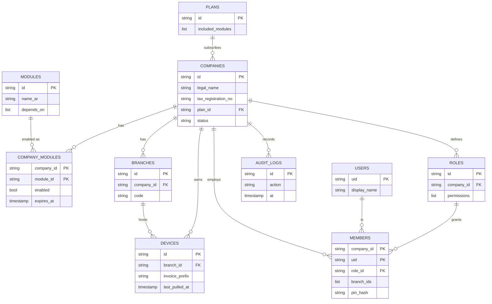
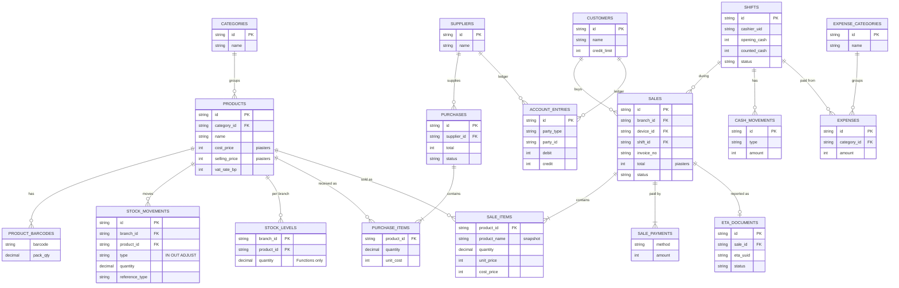

# خطة قاعدة البيانات متعددة الشركات (Multi-tenant) — Tashil ERP

> الحالة: مقترح للمراجعة · التاريخ: 2026-11-25
> الملفات المرتبطة: [`tashil-erp.dbml`](./tashil-erp.dbml) (مخطط ER كامل، يتفتح في [dbdiagram.io](https://dbdiagram.io) من Import > DBML)

## 0. الخلاصة في سطور

| السؤال | القرار المقترح |
|---|---|
| الداتا هتتخزن فين على السحابة؟ | **Cloud Firestore (Native mode)** في مشروع Firebase واحد للإنتاج |
| "قاعدة بيانات لكل تاجر" هتتعمل إزاي؟ | كل شركة ليها **مساحة معزولة منطقيًا** تحت المسار `/companies/{companyId}/…`، والـ 11 سيستم بيقروا ويكتبوا في نفس المساحة دي |
| العزل والأمان؟ | Firebase Auth + **Custom Claims** (`cid`, `role`, `mods`) + **Security Rules** بتمنع أي حد يقرا خارج شركته |
| الصلاحيات؟ | Roles لكل شركة (owner / manager / cashier / storekeeper / accountant / custom) فيها permissions بصيغة `module.action` |
| تفعيل 5 أو 6 سيستمات بس؟ | جدول `company_modules` + الـ claim `mods`، والـ Rules والتطبيق والداشبورد بيقفلوا أي موديول مش مفعّل |
| على الجهاز؟ | Drift/SQLite زي ما هو، **ملف قاعدة بيانات منفصل لكل شركة** على الجهاز، وSyncOutbox بيرفع لـ Firestore |
| التقارير الكبيرة؟ | Cloud Functions بتعمل `daily_summaries`، وبعدين تصدير لـ **BigQuery** للتحليلات الثقيلة |
| قاعدة منفصلة فعليًا لتاجر معيّن؟ | متاحة كـ "Enterprise tier": Firestore بيسمح بقواعد متعددة في نفس المشروع (حد 100 لكل مشروع)، ونفس الكود يشتغل عليها لأن المسارات واحدة |

**ليه مش Postgres (Cloud SQL / Firebase SQL Connect / Supabase)؟** لأن أهم متطلب عندنا هو **Offline-first على SUNMI**، وFirestore هو الوحيد في منظومة Google اللي فيه offline قراءة وكتابة جاهز ومُدار بالكامل، وبيتوسع لوحده ويبدأ مجاني. Postgres أقوى في التقارير والـ joins، وده بنعوّضه بـ BigQuery. التفاصيل في القسم 2.

---

## 1. المتطلبات اللي الخطة مبنية عليها

1. السوبر أدمن (فريق Tashil) يكريت **شركة**، والشركة يتفتح لها مساحة بيانات واحدة مشتركة بين الـ 11 سيستم: Core، Products، Inventory، Receiving، POS، Reports، Customers & Suppliers، Sync & Admin، Cash drawer & Shifts، Credit accounts، Expenses، ETA e-invoice.
2. الشركة ممكن تاخد كل السيستمات أو جزء منها (مثلا 5 أو 6).
3. جوه الشركة فيه أدمن الشركة (owner) ومستخدمين بأنواع وصلاحيات مختلفة، ومحتمل فروع وأجهزة POS متعددة.
4. البيع لازم يشتغل من غير إنترنت على SUNMI V3، والمزامنة تحصل في الخلفية.
5. الفلوس integer بالقروش، والفواتير والحركات مبتتمسحش (cancel + حركة عكسية).
6. تفضيل منظومة Google/Firebase.

---

## 2. مقارنة الخيارات (Deep research)

### 2.1 أشكال الـ multi-tenancy الممكنة

| الشكل | إزاي | مميزات | عيوب | مناسب لينا؟ |
|---|---|---|---|---|
| **A. مساحة لكل شركة داخل قاعدة واحدة** (`/companies/{cid}/...`) | كل البيانات تحت مسار الشركة | أبسط تشغيل، deploy واحد للـ Rules والـ Indexes، مجاني في البداية (قاعدة واحدة بس مجانية لكل مشروع)، مفيش حد لعدد الشركات | العزل منطقي (بالـ Rules) مش فيزيائي | ✅ **الاختيار الافتراضي** |
| **B. قاعدة Firestore منفصلة لكل شركة** (named databases) | `firestore.database('tenant-x')` | عزل فيزيائي، backup/restore وحذف لكل شركة لوحدها | الحد **100 قاعدة لكل مشروع** (ممكن تطلب زيادة من الدعم)، القاعدة المجانية واحدة بس والباقي بفلوس، لازم تعمل deploy للـ Rules والـ Indexes لكل قاعدة، الـ Functions triggers لازم تتسجل لكل قاعدة | ⚠️ للتجار الكبار بس (Enterprise) |
| **C. مشروع Firebase لكل شركة** | مشروع كامل لكل تاجر | أقصى عزل وفصل فواتير | تشغيل مرهق جدًا (apps, keys, deploys, monitoring لكل مشروع)، صعب الداشبورد المركزي | ❌ |
| **D. Postgres + Row Level Security** | جدول واحد فيه `company_id` و RLS policy | SQL كامل، joins، تقارير، constraints | محتاج sync engine بنفسك للـ offline، سيرفر شغال 24 ساعة | ❌ كأساس، ✅ كـ analytics لاحقًا |

### 2.2 مقارنة المنتجات

| | **Cloud Firestore** | **Firebase SQL Connect** (اسمه القديم Data Connect) / Cloud SQL Postgres | **Supabase** (Postgres + RLS) |
|---|---|---|---|
| تبع Google؟ | ✅ | ✅ | ❌ |
| Offline على الموبايل | **قراءة وكتابة مدمجين** (مفعّل افتراضيًا على Android) | **Query cache اختياري** للقراءة بس | مش مدمج، محتاج PowerSync أو حل خاص |
| مع Drift + SyncOutbox بتاعنا | ممتاز: الـ outbox يكتب documents بنفس الـ `localUuid` (idempotent) | محتاج API mutations لكل جدول وحل تعارضات بإيدك | نفس الكلام |
| عزل الشركات | Security Rules + custom claims | `@auth` في الـ GraphQL operations أو RLS في Postgres | RLS قوي جدًا |
| تقارير و joins | ضعيف، بنعوّضه بـ summaries + BigQuery | ممتاز | ممتاز |
| التكلفة في البداية | Free tier يومي (قاعدة واحدة مجانية)، ادفع حسب الاستخدام | Cloud SQL instance شغال باستمرار حتى لو مفيش استخدام | Free tier ثم اشتراك شهري |
| التوسع | تلقائي بالكامل | محتاج تكبير الـ instance | حسب الخطة |
| Realtime للداشبورد | مدمج | محدود | مدمج |

**النتيجة:** Firestore بشكل **A** هو الأنسب للـ POS اللي شغال offline، ومعاه:
- **Cloud Functions** للعمليات الحساسة والمحسوبة (رصيد المخزون في السحابة، أرصدة العملاء، ترقيم ETA، الإرسال لمصلحة الضرائب).
- **BigQuery** (عن طريق إضافة Firestore → BigQuery export) للتقارير الثقيلة والتحليلات عبر سنين.
- **Cloud Storage** للمرفقات (صور المنتجات، إيصالات المصروفات) بمسار `companies/{cid}/...` وRules بنفس المنطق.
- **Secret Manager** لمفاتيح ETA لكل شركة. ممنوع تتخزن في Firestore أو في الريبو.

### 2.3 الهوية: Firebase Auth عادي ولا Identity Platform multi-tenancy؟

Identity Platform فيه "tenants" بمعنى **مجموعات مستخدمين منفصلة**، كل tenant ليه users وطرق دخول خاصة بيه. ده مفيد لما كل عميل عنده SSO خاص (SAML/OIDC)، لكنه:
- محتاج upgrade لـ Identity Platform وبيمنع نفس الشخص يبقى عضو في شركتين بنفس الحساب.
- مش ضروري لينا دلوقتي.

**القرار:** Firebase Auth عادي (هو أصلًا Identity Platform تحت) + **Custom Claims** للشركة والدور. الـ claims حدها **1000 byte**، فبنحط فيها الحاجات الصغيرة بس:

```json
{ "cid": "acme", "role": "cashier", "bids": ["b1"], "mods": ["pos","products","inventory","cash_shifts","parties"], "pv": 7 }
```

- `pv` = permissions version: لما الأدمن يغيّر صلاحية، الـ Function تزوّد الرقم ويتعمل refresh للتوكن.
- السوبر أدمن: `{ "sa": true }`.
- المستخدم اللي شغال في أكتر من شركة: الـ claims بتحمل **الشركة النشطة** بس، والتبديل بيتم بـ callable function `switchCompany(cid)` بعد التأكد من العضوية.

### 2.4 دخول جهاز الـ POS والكاشير

- **الجهاز نفسه** بيتسجل مرة واحدة (Sync & Admin): الأدمن يطلع QR/كود تفعيل من الداشبورد، الجهاز يبعته لـ function `activateDevice`، والـ function ترجّع **custom token** لحساب `device_<id>` فيه claims `{cid, bid, did}`. ده اللي بيعمل sync.
- **الكاشير** بيدخل على الجهاز بـ **PIN** (الـ hash بتاعه متزامن في `members.pin_hash`)، فالتبديل بين الكاشيرات يشتغل offline، وكل فاتورة متسجل عليها `cashier_uid`.
- لو الجهاز اتسرق: الأدمن يعمل revoke، الـ function تقفل حساب الجهاز وتلغي التوكن.

---

## 3. هيكل البيانات في Firestore

```
/platform/modules/{moduleId}           ← كتالوج الـ 11 موديول (للسوبر أدمن)
/platform/plans/{planId}
/platformAdmins/{uid}
/users/{uid}                            ← بروفايل عام للشخص

/companies/{cid}                        ← بيانات الشركة + status + planId
  /modules/{moduleId}                   ← enabled, expiresAt, settings
  /branches/{branchId}
  /roles/{roleId}                       ← permissions: ["pos.sell","pos.refund",...]
  /members/{uid}                        ← roleId, branchIds, pinHash, status
  /devices/{deviceId}                   ← invoicePrefix, lastPulledAt, status
  /counters/{key}
  /auditLogs/{id}

  /categories/{id}  /units/{id}  /products/{id}  /productBarcodes/{id}       ← Products
  /stockMovements/{id}  /stockLevels/{branchId_productId}                    ← Inventory
  /customers/{id}  /suppliers/{id}                                           ← Customers & Suppliers
  /purchases/{id}        (items جوه الـ document كـ array)                    ← Receiving
  /sales/{id}            (items + payments جوه الـ document)                   ← POS
  /shifts/{id}  /cashMovements/{id}                                          ← Cash drawer & Shifts
  /accountEntries/{id}                                                       ← Credit accounts
  /expenseCategories/{id}  /expenses/{id}                                    ← Expenses
  /eta/settings  /etaDocuments/{id}                                          ← ETA e-invoice
  /dailySummaries/{branchId_yyyyMMdd}                                        ← Reports (Functions بس تكتب)
```

قواعد التصميم:
1. **الـ document id = الـ `localUuid`** اللي اتولّد على الجهاز (UUIDv7 عشان يترتب زمنيًا). إعادة إرسال نفس العنصر من الـ outbox مش بتكرره.
2. **collections مسطحة تحت الشركة** (مش متداخلة تحت الفرع). الفرع عبارة عن field `branchId`، عشان تقارير الشركة كلها تبقى query واحدة.
3. **بنود الفاتورة جوه الفاتورة** (array) بدل subcollection: قراءة واحدة بدل N، والفاتورة بعيدة جدًا عن حد الـ 1 MiB.
4. **الأرقام المشتقة** (`stockLevels`, أرصدة العملاء والموردين, `dailySummaries`) بتحسبها **Cloud Functions** من الحركات (append-only). الأجهزة ممنوع تكتبها. ده بيحل مشكلة جهازين بيبيعوا نفس المنتج في نفس الوقت من غير تعارض.
5. كل document فيه: `createdAt`, `updatedAt` (server timestamp), `createdBy`, `deviceId`, `version`.

### المزامنة (Drift ⇄ Firestore)

- **Push:** الـ SyncOutbox بيبعت batches (لحد 500 عملية) بـ `set(merge)` على `/companies/{cid}/{collection}/{localUuid}`. الـ Rules بتتأكد إن `cid` مطابق للتوكن وإن الموديول مفعّل.
- **Pull:** لكل collection: `where updatedAt > lastPulledAt order by updatedAt limit 500`، والـ cursor يتحفظ في Drift (ومنه نسخة في `devices/{id}.lastPulledAt` للمتابعة). الجهاز بيسحب بيانات فرعه بس (`where branchId == bid`) للجداول الكبيرة.
- **التعارض:** الكتالوج (منتجات/أسعار) = last-writer-wins بالـ `updatedAt` والـ `version`. الحركات المالية والمخزنية append-only فمفيش تعارض.
- إحنا **مش محتاجين** Firestore offline cache على الـ POS لأن Drift هو مصدر الحقيقة المحلي؛ الـ Angular dashboard بيستخدم Firestore realtime عادي.
- على الجهاز: ملف Drift منفصل لكل شركة (`tashil_{cid}.sqlite`)، فلو الجهاز اتنقل لشركة تانية مفيش خلط.

---

## 4. الصلاحيات وتفعيل الموديولات

### 4.1 المستويات

| المستوى | مين | يقدر يعمل إيه |
|---|---|---|
| Super admin (`sa`) | فريق Tashil | يكريت شركات، يفعّل/يقفل موديولات، يعلّق شركة، يدخل كـ support |
| Owner | صاحب الشركة | كل حاجة جوه شركته، يضيف مستخدمين وفروع وأجهزة وأدوار |
| Manager / Accountant / Storekeeper / Cashier | موظفين | حسب الـ permissions في الـ role بتاعهم، وفي الفروع المحددة ليهم |

### 4.2 Permissions (أمثلة)

`products.view`, `products.edit`, `products.price_change`, `inventory.view`, `inventory.adjust`, `receiving.create`, `pos.sell`, `pos.discount`, `pos.refund`, `pos.cancel`, `shifts.open_close`, `shifts.cash_out`, `credit.sell_on_credit`, `credit.collect`, `expenses.create`, `reports.view_sales`, `reports.view_profit`, `eta.submit`, `admin.users`, `admin.devices`.

كل permission بتبدأ باسم الموديول، فلو الموديول مش مفعّل للشركة، الـ permission بتتجاهل أوتوماتيك.

### 4.3 تفعيل موديولات لشركة

1. السوبر أدمن يختار الموديولات من الداشبورد → function `setCompanyModules(cid, modules)`.
2. الـ function تتحقق من الاعتماديات (POS محتاج Products + Inventory، Credit محتاج Customers & Suppliers، ETA محتاج POS)، وتكتب `/companies/{cid}/modules/*`.
3. تحدّث الـ `mods` في claims كل الأعضاء والأجهزة، وتزوّد `pv`.
4. التطبيق بيخفي الشاشات، والـ Rules بتمنع الكتابة في collections الموديول المقفول.

### 4.4 Security Rules (مسودة)

```js
rules_version = '2';
service cloud.firestore {
  match /databases/{db}/documents {
    function signedIn()     { return request.auth != null; }
    function superAdmin()   { return signedIn() && request.auth.token.sa == true; }
    function inCompany(cid) { return signedIn() && request.auth.token.cid == cid; }
    function hasModule(m)   { return m in request.auth.token.mods; }
    function isOwner()      { return request.auth.token.role == 'owner'; }
    function inBranch(b)    { return !('bids' in request.auth.token)
                                     || request.auth.token.bids.size() == 0
                                     || b in request.auth.token.bids; }
    // Fine-grained permission check (costs one document read, cached per request)
    function can(cid, perm) {
      return isOwner() || perm in get(/databases/$(db)/documents/companies/$(cid)/roles/$(
               get(/databases/$(db)/documents/companies/$(cid)/members/$(request.auth.uid)).data.roleId
             )).data.permissions;
    }

    match /companies/{cid} {
      allow read:  if superAdmin() || inCompany(cid);
      allow write: if superAdmin();

      match /modules/{m}   { allow read: if inCompany(cid) || superAdmin(); allow write: if superAdmin(); }
      match /members/{uid} { allow read: if inCompany(cid); allow write: if false; } // via Functions only

      match /sales/{id} {
        allow read:   if inCompany(cid) && hasModule('pos');
        allow create: if inCompany(cid) && hasModule('pos')
                      && inBranch(request.resource.data.branchId)
                      && request.resource.data.total is int;
        allow update: if inCompany(cid) && hasModule('pos')
                      && request.resource.data.diff(resource.data).affectedKeys()
                           .hasOnly(['status','updatedAt','version','cancelReason']);
        allow delete: if false;
      }

      match /stockLevels/{id}    { allow read: if inCompany(cid) && hasModule('inventory'); allow write: if false; }
      match /dailySummaries/{id} { allow read: if inCompany(cid) && hasModule('reports');   allow write: if false; }
      // ... same pattern for the other module collections
    }
  }
}
```

> الأجهزة (`device_<id>`) بتاخد claims فيها `role: "device"` وصلاحية الكتابة على collections الموديولات المفعّلة بس، ومن غير قراءة لبيانات الأعضاء الحساسة.

---

## 5. مخطط ER

المخطط الكامل (كل الجداول والأعمدة) في [`tashil-erp.dbml`](./tashil-erp.dbml). الرسم تحت مقسوم لجزئين عشان يتقري.

### 5.1 المنصة والـ Core



### 5.2 بيانات الموديولات (كلها تحت `companies/{cid}`)



### 5.3 مين بيملك إيه

| الموديول | Collections | بيكتبها مين |
|---|---|---|
| Core | companies, modules, branches, roles, members, counters | السوبر أدمن / Owner عن طريق Functions |
| Sync & Admin | devices, auditLogs | Functions + الأجهزة (heartbeat) |
| Products | categories, units, products, productBarcodes | Owner/Manager (داشبورد أو جهاز) |
| Inventory | stockMovements (أجهزة)، stockLevels (Functions) | |
| Receiving | purchases | الأجهزة/الداشبورد، والحركات المخزنية معاها |
| POS | sales | الأجهزة |
| Customers & Suppliers | customers, suppliers | الأجهزة/الداشبورد |
| Cash drawer & Shifts | shifts, cashMovements | الأجهزة |
| Credit accounts | accountEntries (append-only)، الرصيد في customers/suppliers بالـ Functions | |
| Expenses | expenseCategories, expenses | الأجهزة/الداشبورد |
| ETA e-invoice | eta/settings (Owner)، etaDocuments (Functions بس) | |
| Reports | dailySummaries (Functions بس) + BigQuery | |

---

## 6. دورة حياة الشركة (Provisioning)

1. السوبر أدمن يملأ فورم "شركة جديدة" في Angular → callable `createCompany({legalName, planId, modules, ownerPhone/email})`.
2. الـ function في **transaction واحدة**: تكريت `/companies/{cid}`، الـ modules، فرع رئيسي، الأدوار الافتراضية (owner, manager, cashier, storekeeper, accountant)، عضوية الـ owner، والـ counters.
3. تكريت أو تلاقي حساب Auth للـ owner، تحط الـ claims، وتبعت دعوة (رابط دخول / SMS).
4. الـ owner يدخل الداشبورد، يضيف فروع ومستخدمين وأجهزة.
5. **تعليق شركة:** `status = suspended` → الـ Rules تمنع الكتابة، والأجهزة تفضل تقرا بياناتها المحلية بس.
6. **حذف/تصدير شركة:** export لـ Cloud Storage بفلتر `companies/{cid}` (أو كوبي للـ named database لو Enterprise) ثم حذف بالـ recursive delete. البيانات المالية تتحفظ حسب المدة القانونية قبل الحذف.
7. **ترقية لـ Enterprise (قاعدة فعلية منفصلة):** تكريت named database `tenant-{cid}` في نفس المشروع ونقل مسار الشركة ليها، والتطبيق بياخد اسم القاعدة من `companies/{cid}.databaseId`. لأن المسارات هي هي، الكود مش بيتغير.

---

## 7. ملاحظات تشغيلية

- **مكان القاعدة (location) مبيتغيرش بعد الإنشاء.** المقترح منطقة قريبة من مصر (مثلا `europe-west1` أو `me-central2`)، ونقيس الـ latency من جهاز SUNMI قبل ما نثبّت.
- **مشاريع منفصلة للبيئات:** `tashil-dev`، `tashil-staging`، `tashil-prod`. الـ multi-tenancy جوه كل مشروع، مش مشروع لكل تاجر.
- **App Check** مفعّل على Firestore والـ Functions عشان محدش يكلم الـ API من برا التطبيق.
- **Backups:** Firestore scheduled backups يومي + PITR (point-in-time recovery) للإنتاج.
- **Indexes مطلوبة:** `(branchId, updatedAt)` و`(updatedAt)` لكل collection بيتعملها pull، `(branchId, date)` لـ sales وexpenses، `(partyId, createdAt)` لـ accountEntries.
- **Hot documents:** أي document بيتكتب كتير (زي counters أو stockLevels لمنتج بيتباع جدًا) يتحدّث من Function بـ `FieldValue.increment`. ترقيم الفواتير بيتم على الجهاز (`DEVICE-yyyyMMdd-NNNN`) فمش محتاج counter مركزي.
- **التكلفة:** أكبر بند هو عدد الـ reads/writes. البنود جوه الفاتورة، والـ pull بـ cursor، والـ summaries الجاهزة للداشبورد بيقللوا ده جدًا. نراجع الأرقام بعد pilot على 2-3 تجار.
- **الأسرار:** مفاتيح ETA والـ service accounts في Secret Manager فقط. Firestore بيحفظ اسم الـ secret بس.

---

## 8. خطوات التنفيذ المقترحة

1. إضافة `companyId` و`branchId` و`deviceId` لـ `SyncColumns` في Drift، وتغيير الـ PK في الـ sync لـ `localUuid` (UUIDv7)، وملف DB لكل شركة.
2. مشروع Firebase (`tashil-dev`) + Firestore Native + Auth + App Check.
3. Cloud Functions: `createCompany`, `setCompanyModules`, `inviteMember`, `setMemberRole`, `activateDevice`, `switchCompany` + triggers: stockLevels, balances, dailySummaries, auditLogs.
4. `firestore.rules` كاملة + **اختبارات Rules بالـ Emulator** (أهم اختبار: مستخدم شركة A ميقدرش يقرا أي حاجة من شركة B).
5. Sync push/pull في Flutter على الـ outbox الموجود.
6. Angular: شاشات السوبر أدمن (الشركات والموديولات) وشاشات الـ Owner (المستخدمين والأدوار والأجهزة).
7. BigQuery export + أول تقارير.

---

## المصادر

- Firestore quotas (100 قاعدة لكل مشروع، قاعدة واحدة مجانية، حجم الـ document 1 MiB): https://firebase.google.com/docs/firestore/quotas
- Custom claims (حد 1000 byte): https://cloud.google.com/identity-platform/docs/how-to-configure-custom-claims
- Identity Platform multi-tenancy: https://cloud.google.com/identity-platform/docs/multi-tenancy-managing-tenants
- Firebase SQL Connect (Data Connect سابقًا، Cloud SQL for PostgreSQL): https://firebase.google.com/docs/sql-connect
- Flutter, Choose a database (Firestore offline مدمج، SQL Connect query cache اختياري): https://docs.flutter.dev/data-and-backend/persistence/choose-a-database
