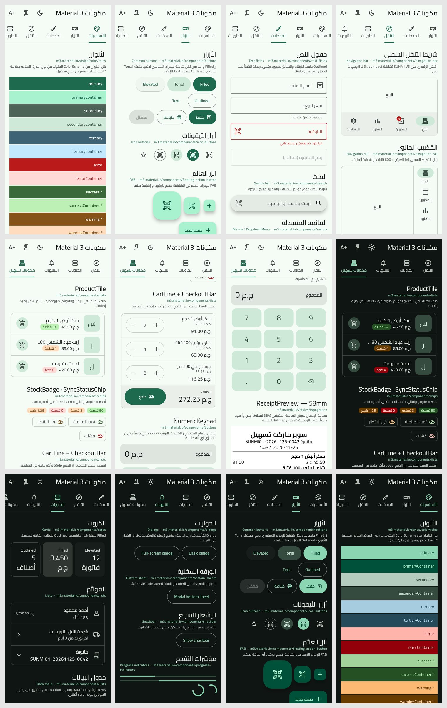

# Tashil design system (Material Design 3)

These are the fixed UI rules for the Tashil Flutter app. The **component
playground** shows every rule live, with the real theme, light and dark, RTL.

## Open the playground

| How | Command / action |
| --- | --- |
| Standalone (no database) | `flutter run -t lib/main_playground.dart` |
| In a browser | `flutter run -d chrome -t lib/main_playground.dart`, or the GitHub Pages site once Pages is enabled (Settings > Pages > Source: GitHub Actions); it redeploys on every push to `main` |
| Inside the app (debug builds only) | Home screen, widgets icon in the app bar |
| Screenshots of every tab, light + dark, at SUNMI V3 size | `flutter test tool/screenshots --update-goldens` (PNGs land in `build/playground_shots/`) |

The app bar of the playground toggles dark mode, RTL/LTR and large text (1.3x)
so you can check any component under each condition.

## Sources of truth

1. **[m3.material.io](https://m3.material.io/)** for what a component is and
   when to use it. Every playground section links to its spec page.
2. **Flutter's Material 3 widgets** (`package:material_ui`) for how it is built.
   The official reference app is
   [flutter/samples `material_3_demo`](https://github.com/flutter/samples/tree/main/material_3_demo).
3. **This file + `lib/core/design/`** for Tashil-specific choices.

## Where things live

| Path | What |
| --- | --- |
| `lib/core/design/tokens.dart` | Seed colour, spacing, radii, sizes, semantic colours (success/warning) |
| `lib/core/design/app_theme.dart` | `TashilTheme.light()` / `.dark()`; the only place component defaults change |
| `lib/core/design/app_localizations.dart` | Arabic locale + Material/Cupertino/Widgets delegates |
| `lib/core/design/money.dart` | Piastres to display text |
| `lib/core/design/bidi.dart` | Keep invoice numbers, barcodes, dates left-to-right inside Arabic |
| `lib/core/design/widgets/` | `ButtonGroup` (M3 Expressive) and Tashil composites: `ProductTile`, `CartLine`, `QtyStepper`, `CheckoutBar`, `NumericKeypad`, `StockBadge`, `SyncStatusLabel`, `MoneyText`, `EmptyState`, `ReceiptPreview` |
| `lib/features/playground/` | The playground page, one file per tab |

## Rules

### Colour
- All colours come from `Theme.of(context).colorScheme`, generated by
  `ColorScheme.fromSeed(TashilColors.seed)`. Never write a hex colour in a screen.
- M3 has no success/warning roles. Use `TashilSemanticColors.of(context)`
  (`success`, `warning` and their `container`/`on*` pairs). They follow
  light/dark automatically.
- Stock: green = available, orange = at or below minimum, red (`error`) = out.

### Typography
- Font: **Cairo** (SIL OFL), bundled in `assets/fonts/cairo`. Never fetched
  at runtime, because the device is often offline.
- Use `Theme.of(context).textTheme.*` only. No hand-written `fontSize` in
  screens. The one exception is `ReceiptPreview`, which is sized for the
  printer, not the screen.
- Digits are **Western (0-9)** everywhere, including sample data.

### Money and numbers
- Money is stored as integer piastres. Show it with `MoneyText` or
  `Money.format` (`1,250.50 ج.م`). Never format a `double` price.
- Quantities show without trailing zeros (`Money.qty`).
- Invoice numbers, barcodes, phone numbers and dates inside Arabic text go
  through `Bidi.ltr(...)`, otherwise their parts get reordered.

### Layout and touch (SUNMI V3: ~360 dp wide, compact window)
- 4 dp grid: use `TashilSpacing` (`xs 4`, `sm 8`, `md 12`, `lg 16`, `xl 24`,
  `xxl 32`). Page margin is 16.
- Minimum touch target 48 dp (all buttons are themed to it). Primary POS
  actions (pay, confirm) are 56 dp (`TashilSizes.posButtonHeight`).
- Corners follow the M3 shape scale (`TashilRadius`).
- Use `EdgeInsetsDirectional` / `AlignmentDirectional` so RTL and LTR both work.
- Price + badge style rows use `Wrap`, not `Row`, so they never overflow at
  360 dp. The playground test fails on any overflow.

### Components
| Need | Use | Rule |
| --- | --- | --- |
| Main action of a screen | `FilledButton` | One per screen |
| Secondary action | `FilledButton.tonal` / `OutlinedButton` | |
| Cancel / low emphasis | `TextButton` | |
| Most important action (scan, add) | `FloatingActionButton` | |
| Main action that needs a label (new item, new invoice) | `FloatingActionButton.extended` | Collapses to icon on scroll down, expands on scroll up |
| 2-6 related creation actions from one FAB | `FabMenu` | Focus starts on the close button |
| 2-5 exclusive options (payment method, report period) | `ButtonGroup` connected | Replaces `SegmentedButton`, which M3 no longer recommends. Do not use `SegmentedButton` |
| Related actions or toggles in one row | `ButtonGroup` standard | Pressed button widens, corners morph |
| Icon-only action | `IconButton` | Always has a `tooltip` |
| Text input | `TashilTextField` (official `TextField`, outlined from the theme) inside a `FormColumn` | Label always; required `*` + one `RequiredFieldsNote`; error replaces supporting text, with an error icon; numeric keyboard for numbers |
| Search in a view (products, suppliers) | `TashilSearch` (official `SearchAnchor` + `SearchBar`) | Bar over the content it searches; full screen on compact, docked from 600dp; recent before typing, grouped results + filter chips while typing |
| Search as a secondary action | `TashilSearch(asIconButton: true)` in the app bar | |
| Contextual action (print receipt, share) | `ActionChip` with icon (assist) | Starts with a verb; below the main content; `.elevated` only over an image |
| Filtering lists | `FilterChip` | One set is single- or multi-select, never both. `ChoiceChip` is not an M3 variant: do not use it |
| Filter that opens options (category ▾) | `MenuFilterChip` | The whole chip opens the menu |
| Values the user types (extra barcodes, tags) | `InputChipField` | Enter or comma adds; Backspace selects then deletes; ✕ at the end |
| System suggestions (recent searches) | `ActionChip` without icon (suggestion) | Nouns or short phrases |
| Read-only state (stock, sync) | `StockBadge`, `SyncStatusLabel` | Not chips: M3 chips are always interactive |
| A value from a range with immediate effect (discount %, volume, print darkness) | `TashilSlider`; `CenteredSlider` around a middle default; `RangeSlider` for min and max | 2024 slider look from the theme; sizes XS to XL; inset icon only from M |
| Date in a form | `DateField` | Typed in the field (day/month/year, Arabic digits accepted) + calendar button: modal on compact, docked from 600dp |
| Report period | `ButtonGroup` presets + `showDateRangePicker` (calendar only) for a custom range | Full screen on compact |
| Time in a form | `ScrollTimePicker` inline | Keyboard toggle always present; 12/24h from the device |
| Number or unit from a short list (weight, quantity, unit) | `ScrollField` inline + `ScrollFieldInputToggle` next to it | Up to 4 digits; steps for long runs; label each field when side by side; not for time |
| Time in a dialog | `showTimePicker` (dial) | Dial only in dialogs. Preset times use `ButtonGroup` or a menu |
| App shell (picks bar or rail by width) | `AdaptiveNavigationScaffold` | Bar below 600dp, collapsed rail from 600, expanded rail from 1200 |
| Main navigation on the device | `HidingNavigationBar` (official `NavigationBar`) | 3 to 5 destinations, labels always, 64dp, hides on scroll down |
| Wide screens (600 dp and up) | `TashilNavigationRail` (official `NavigationRail`) | Collapsed 96dp; menu button expands it; FAB under the menu button |
| Secondary destinations | Expanded rail; on compact `ModalNavigationRail` from the app bar menu | `NavigationDrawer` is no longer recommended by M3: do not use it |
| Name of an icon-only button | `tooltip:` on `IconButton` (plain tooltip from the theme) | One short line; not on elements that already have text |
| Explain a term or a new feature | `RichTooltip` (transient, or `persistent: true` on tap) | One-line subhead, up to two text buttons; never critical information |
| Confirm an irreversible action | `AlertDialog` via `showTashilDialog` | Text buttons; confirm says what happens ("إلغاء الفاتورة") |
| Acknowledge (printer out of paper) | `AlertDialog`, one action | Only acknowledgement dialogs have a single button |
| Pick one item (return reason) | `showChoiceDialog` | Title and buttons pinned, list scrolls, confirm disabled until a choice |
| Create/edit form | `FormDialog` | Full screen on compact, basic dialog from 600dp; asks before discarding edits |
| Actions on an item (edit, copy, delete) | `MenuButton` + `groupedMenuChildren` | Trigger stays pressed while open; groups separated by gaps; unavailable items shown disabled |
| Actions from long press / right click | `ContextMenuRegion` | Same items as the item's overflow menu |
| Pick one value in a form (unit, supplier) | `DropdownMenu` | `enableFilter` for long lists (10+) |
| Pick several values (report columns) | `CheckboxMenuButton` in a `MenuAnchor` | `closeOnActivate: false`: stays open until dismissed |
| Many actions on an item, or actions needing icons and descriptions (mobile) | `showActionSheet` (modal bottom sheet) | Opens at content height, never above 50%; long lists pull to full screen with a close button |
| Content that works next to the screen (cart over products) | `StandardBottomSheet` | Preset heights; tap the handle to change; collapse button at full height |
| Details that should be a side sheet on wide screens | `showAdaptiveSheet` | Bottom sheet below 840dp, side sheet from 840dp |
| Filters or settings over the screen | `showSideSheet` (modal side sheet) | End edge (left in Arabic), max 400dp, close button, actions at the bottom after a divider |
| Details next to a list on tablet | `StandardSideSheetLayout` | The body shrinks to make room; both stay usable |
| Short update about something the app did, maybe with undo | `showTashilSnackBar` (official `SnackBar`, floating) | Text only, one text action; replaces the current one; not for errors that need a decision |
| Persistent state (offline, shift closed) | `MaterialBanner` | |
| Reports | `DataTable` in a horizontal scroll | Not an official M3 component; reports only |
| Amount / quantity entry | `NumericKeypad` | Always 7-8-9 on top, even in RTL |
| Receipt | `ReceiptPreview` | 384 dots wide, black on white, later rasterised for the printer |

### Dividers
Source: **m3.material.io/components/divider/guidelines**. Tokens:
`TashilDividerInset` in `tokens.dart`. Live: playground tab "الحاويات".

- Full width (`Divider()`): between unrelated sections, and between content
  and its actions (a group of settings and the next group; cart lines and
  the total).
- Inset: between related items of one list. Plain lists:
  `indent`/`endIndent: TashilDividerInset.both` (16). Lists with a leading
  icon or image: start at the text (`afterIcon` 56, `afterThumbnail` 88),
  end 16. A test checks the text really starts there in RTL and LTR.
- Use them sparingly: rows with the same format (search results, product
  lists in a scroll) are separated by spacing alone.
- `VerticalDivider` only on wide layouts (list + details, rail + content).

### Loading and progress
Sources: **m3.material.io/components/loading-indicator/guidelines** and
**/progress-indicators/guidelines**. Code:
`lib/core/design/widgets/loading_indicator.dart`, theme in `app_theme.dart`.
Live: playground tab "التنبيهات".

| Expected wait | Show |
| --- | --- |
| Under 200ms | Nothing (`DelayedLoadingIndicator` waits 200ms before showing) |
| 200ms to 5s, unknown length | `LoadingIndicator`, centred in the empty space |
| Over 5s, or progress is known | `LinearProgressIndicator` / `CircularProgressIndicator`, determinate when possible |

- Never switch from a loading indicator to a progress indicator mid-process.
- Linear: on the top edge of its container or under the app bar.
- Short task started by a button (printing): small circular indicator
  inside the button, button disabled.
- Pull to refresh: official `RefreshIndicator.noSpinner` + a contained
  `LoadingIndicator` on top of the list.
- Progress indicators use the M3 2024 look (gap, stop dot, rounded ends):
  `ProgressIndicatorThemeData(year2023: false)` in the theme.
- Not adopted: the optional Expressive *wavy* progress style. Flutter does
  not ship it; revisit when it does.

### Dialogs
Source: **m3.material.io/components/dialogs/guidelines**. Code:
`lib/core/design/widgets/dialogs.dart`. Live: playground tab "التنبيهات".

- Only for high-importance prompts that block the task. Anything else is a
  `SnackBar` (or a menu for options).
- Open with `showTashilDialog` (M3 enter/exit: fade + scale), not
  `showDialog`.
- Headline: a short clear statement or question, no apologies, no
  "هل أنت متأكد؟".
- Text buttons, at most two. Confirm is at the end (left in Arabic) and
  names the result; dismiss comes before it and is never disabled. A
  single button only for acknowledgement. No "اعرف أكتر" third action.
- Full-screen dialogs: compact screens only, opened from the button with a
  container transform, ✕ is the only navigation, the save action is named.
  Field errors inline; a dialog only when saving fails. Closing with edits
  asks "تتجاهل التعديلات؟".
- Long content scrolls inside; title and buttons stay fixed.

### Text fields
Source: **m3.material.io/components/text-fields/guidelines**. Code:
`lib/core/design/widgets/text_fields.dart` (`TashilTextField`,
`RequiredLabel`, `RequiredFieldsNote`, `FormColumn`), on the official
`TextField`. Live: playground tab "المدخلات", section "حقول النص".

- Variant: **outlined** everywhere (M3: less emphasis, simpler forms
  with many fields). Filled and outlined are never mixed in one form or
  region.
- Every field has a label: short, one line, never cut. It may be
  dropped only when an adjacent label sits at the field's leading edge
  (then give the field a semantics label).
- Required: asterisk after the label (read out as "مطلوب"), and one
  `RequiredFieldsNote` at the top of the form. Mark all required fields.
- Input: **single line** (names, prices, barcodes), **multi-line** that
  grows up to 4 lines (short notes), **text area** with a fixed height
  that scrolls (return reason, supplier notes).
- Prefix and suffix text: units ("كجم"), country code ("+20"). In
  Arabic the currency follows the amount, so "ج.م" is a suffix.
- Supporting text: one line ideally. Character counter whenever there is
  a limit (`maxLength`).
- Error text **replaces** the supporting text (never added under it), and
  says how to fix the most likely error. An error icon always shows with
  it. A valid icon (check) can confirm good input, also for colour-blind
  users.
- Icons: leading icon describes the input; trailing icon opens something
  (scan, date picker); the clear icon appears only while there is text.
  Icons swap sides in RTL (Flutter does this). Voice input is not used.
- Read-only: looks like a normal field (not disabled) and says
  "للقراءة بس". Disabled is only for fields that do not apply right now.
- Adaptive: full width on compact; from 600dp `FormColumn` caps fields
  at 560dp at the start edge, never across the whole screen.
- Density: not by default (keeps 48dp targets). A dense layout is a
  setting people choose (`isDense` + compact visual density).

### Sliders
Source: **m3.material.io/components/sliders/guidelines**. Code:
`lib/core/design/widgets/sliders.dart`; the theme opts into Flutter's 2024
slider (`SliderThemeData(year2023: false)`). Live: playground tab
"المدخلات", section "المنزلق".

- For picking from a range where the change **takes effect immediately**
  (people see the effect while moving it). Not for exact numbers: pair
  it with a text field, or use a text field instead.
- Variants: **standard** (starts from zero: discount, volume),
  **centered** (default in the middle: price change -20% to +20%),
  **range** (minimum and maximum: price filter). Range is horizontal only.
- Handle: a bar that narrows while pressed or dragged. Value label above
  it while dragging (one at a time on a range slider). If the value is
  shown elsewhere, for example in a text field, the field comes right
  after the slider in Tab order and both stay in sync.
- Stop indicators come from `divisions`; the handle snaps to the nearest
  one. Keep them few. Plus and minus buttons, or text, at the ends can
  replace stops and help accessibility.
- Sizes (track height): XS 16, S 24, M 40, L 56, XL 96. Active and
  inactive tracks are always the same size. XL only for hero moments.
- Inset icon: only on M, L and XL standard sliders. It moves to the
  inactive track when there is no room, and can change at zero (volume
  to mute). Never on centered or range sliders.
- Vertical: minimum at the bottom, also in Arabic.
- RTL: values grow from right to left (Flutter does this).
- Keyboard: Tab focuses the handle, arrows move one step. Flutter has no
  "Space + arrows" larger step yet.
- Hand-built: sizes, inset icon, centered track and vertical wrapper.
  The slider itself is Flutter's.

### Snackbars
Source: **m3.material.io/components/snackbar/guidelines**. Code:
`lib/core/design/widgets/snackbars.dart` (`showTashilSnackBar`, on the
official `SnackBar` and `ScaffoldMessenger`). Live: playground tab
"التنبيهات", section "الإشعار السريع".

- For short, low-priority updates about something the app already did
  ("اتبعت للطابعة", "اتشال صنف من السلة"). Anything that needs a decision
  or blocks work is a dialog; lasting state (offline) is a banner.
- Text only: no icons, links or styled text. One line where possible,
  two at most (longer text is cut with an ellipsis).
- At most one action, a text button ("تراجع"), never a filled button and
  never "إلغاء" (closing is the close button's job). A long action label
  moves to its own line (Flutter does this).
- Without an action it disappears after 4 seconds. With an action it
  stays until used or closed, so it always gets a close button.
- One at a time. Newer information replaces the current snackbar
  straight away (sync progress, then the result); they never stack.
- Floating from the theme: above the FAB and the navigation bar, never
  in front of them. On compact it spans the width with margins; from
  600dp it is centred, at most 560dp wide, never flush to an edge.
- Also show the result where the action happened (the save button turns
  into "اتحفظ"), so people who miss the snackbar still see it.

### Tooltips
Source: **m3.material.io/components/tooltips/guidelines**. Code:
`lib/core/design/widgets/tooltips.dart` (`plainTooltipTheme` in the app
theme, `appBarTooltipTheme`, `RichTooltip`, `RichTooltipController`).
Live: playground tab "التنبيهات", section "التلميح".

- **Plain** (Flutter's `Tooltip`, also `IconButton.tooltip`): labels
  elements with no text, mostly icon-only buttons. One short line. Not
  needed when the element already has a text label.
- Placement: above the element, 4dp from an element with a boundary (a
  button), 8dp from bare text. In an app bar, below the element
  (wrap the app bar in `TooltipTheme(data: appBarTooltipTheme)`).
- **Rich** (`RichTooltip`, hand-built: Flutter has no rich tooltip yet):
  optional subhead (one line, needed when it opens by itself), supporting
  text, up to two short text buttons side by side. Placed below the
  element towards the end side (bottom right; bottom left in Arabic),
  never covering it, moved in 8dp steps to stay on screen, above the
  element when there is no room below.
- Showing: long press on mobile, hover on desktop. Both kinds disappear
  1.5 s after leaving. Only one tooltip at a time.
- **Persistent rich**: opens on tap, or from `RichTooltipController` to
  introduce a new feature when the page opens. Stays until the person
  taps elsewhere. Never on icon buttons.
- Never hide critical information in a tooltip: use a dialog.

### Dates and times
Sources: **m3.material.io/components/date-pickers/guidelines** and
**/time-pickers/guidelines**. Code: `lib/core/design/widgets/date_time_fields.dart`,
`lib/core/design/app_localizations.dart`.

- Digits are Western everywhere, including Google's own pickers:
  `TashilLocale.delegates` loads the official Arabic translations with
  Latin-digit formatters (`WesternDigitsMaterialLocalizations`).
- The official dialogs' keyboard mode expects hidden right-to-left marks in
  Arabic and rejects `15/4/2027`, so dialogs open in
  `DatePickerEntryMode.calendarOnly` and typing happens in `DateField`
  (`parseTypedDate`).
- Prefer inline pickers (`DateField`, `ScrollTimePicker`) so the form stays
  visible. Dial time picker only inside a dialog.
- Only use a time picker when any minute can be chosen.
- `ScrollTimePicker` is M3 Expressive and not in Flutter yet: ours, built
  on `ListWheelScrollView`, to be replaced when Flutter ships it.

### Scroll fields
Source: **m3.material.io/components/scroll-fields/guidelines** and
**/specs**. Code: `lib/core/design/widgets/scroll_field.dart`. Live:
playground tab "المدخلات", section "حقول التمرير".

- For picking a number or a unit from a list: weight (kilos + grams),
  received quantity + unit. For a time, use the time picker instead.
- Swipe, or tap the value above or below. The centred value snaps into
  place and is larger and darker. Arrow keys and screen reader
  increase/decrease work too.
- Always give a keyboard option (`ScrollFieldInputToggle`) placed next to
  the fields. In text mode numbers accept Arabic-Indic digits, strings
  auto-complete from their first letters, and an invalid value shows an
  error under the field with an error outline.
- Sizes (minimum widths): small 1-2 digits 100dp, medium 3 digits 144dp,
  large 4 digits 186dp. No more than 4 digits; for long runs add steps
  (grams every 50) or use a text field.
- When several fields sit side by side, each gets a label above it.
- Inline is preferred. If there is no room, a non-modal popup; a modal
  dialog only rarely.
- Colours from the spec: container `surfaceContainerLowest`, inactive
  values `outline`, active value `onSurface`, and `primary` for the
  selected container, the selected value and the cursor. Corners 16dp
  (never less). Inactive values are cropped to show there is more.
- Larger windows: pass a taller `height` and wider `width` (or
  `double.infinity` to fill).
- Hand-built: Flutter has no scroll field yet. It is composed from the
  official `ListWheelScrollView` + `FixedExtentScrollPhysics` and
  `TextField`.

### Chips
Source: **m3.material.io/components/chips/guidelines**. Code:
`lib/core/design/widgets/chips.dart`. Live: playground tab "المدخلات".

- Four variants only: assist, filter, input, suggestion.
- Chips always come as a set, never a single chip alone. A filter set never
  has only one option.
- Chips are not buttons. The step that finishes a task (checkout, save form)
  is a button.
- Outlined on plain backgrounds. Elevated only on images. Never use
  elevation to show the pressed state.
- Labels are 20 characters at most. 8 dp between chips. 48 dp touch target
  (from `materialTapTargetSize.padded`).
- More than two rows of chips: switch to one horizontally scrolling row.
- The trailing icon sits at the end of the chip, so on the left in Arabic.

### Navigation
Sources: **m3.material.io/components/navigation-bar/guidelines**,
**navigation-rail/guidelines**, **navigation-drawer/guidelines**. Code:
`lib/core/design/widgets/navigation.dart`. Live: playground tab "التنقل".

- One navigation per screen: the bar on compact, the rail from 600dp.
  Never both at once.
- **Bar:** 3 to 5 destinations, labels always shown, filled icon on the
  selected one, 64dp (Expressive flexible bar). It hides while the content
  scrolls down and comes back on scroll up, but never while a screen
  reader is on.
- **Rail:** collapsed is 96dp with labels under the icons; the menu button
  at the top expands it (240dp+, labels beside icons) to show the
  secondary destinations too. The FAB, if any, sits under the menu button
  and becomes an extended FAB when the rail expands. Its content scrolls
  when it does not fit.
- **Drawer:** M3 no longer recommends the navigation drawer. Secondary
  destinations (customers, suppliers, expenses, shift) live in the
  expanded rail. On compact it opens as a modal over the content from the
  menu button in the app bar (`ModalNavigationRail`, on Flutter's `Drawer`
  for scrim, swipe and back to close).
- Badges: a dot (`badge: 0`) for "something new", a number for a count,
  999+ at most.
- Not adopted: the horizontal bar items for medium windows, because we
  switch to the rail at 600dp; section headers inside the rail, because
  Flutter's `NavigationRail` has no slot for them yet.

### Search
Source: **m3.material.io/components/search/guidelines**. Code:
`lib/core/design/widgets/search.dart`. Live: playground tab "المدخلات",
section "البحث".

- Entry points: a **search bar** over the content it searches (products
  list, suppliers); a **search icon button** in the app bar when search
  is secondary. A search app bar only if search becomes the main, global
  function.
- Focused search: **full screen** on compact (SUNMI), **docked** under
  the bar with a scrim from 600dp. Back releases focus and closes it.
- Before typing: recent searches under "الأخيرة", each removable.
- While typing: results in a list, grouped by category with a label for
  each group ("الأصناف", "الموردين", "العملاء"), groups separated by gaps,
  leading icon or avatar per item, filter chips at the top to narrow.
- A status line ("نتايج سريعة: 3", or "مفيش نتايج") is a live region, so
  screen readers hear that results changed.
- Enter runs the search (so a keyboard-wedge barcode scanner works: it
  types and presses Enter). Choosing a result opens it directly. The
  query stays visible in the bar afterwards, not focused, and goes to
  recent.
- Bar: non-functional search icon at the start; one or two trailing icons
  at most (barcode scan, overflow); a clear button in focused search once
  something is typed. Hint says what is searched ("ابحث في الأصناف").
- Colour `surfaceContainerHigh` (Flutter default). Never put the bar on a
  `surfaceContainer` background: keep surface roles more than one step
  apart.
- Scrolling: the bar may scroll away with the list and come back on
  scroll up (`SliverAppBar(floating: true, snap: true)`), or stay fixed.
- Predictive back on Android comes from Flutter's route.

### Bottom sheets
Source: **m3.material.io/components/bottom-sheets/guidelines**. Code:
`lib/core/design/widgets/sheets.dart`. Live: playground tab "التنبيهات",
section "الورقة السفلية".

- **Modal** (mobile only): instead of a menu or a simple dialog when the
  list of actions is long, or items need icons and descriptions. It blocks
  the screen until an action is chosen or it is dismissed.
- Opens at its content height and never above **50%** of the screen.
  Longer content can be pulled to full screen and scrolls inside; at full
  screen the handle becomes an app bar with a close button.
- Closes by: choosing an action, tapping the scrim, swiping down, the
  close button, or back (predictive back comes from Flutter's route).
- **Standard**: sits next to the main UI and both stay usable (the cart
  over the products grid). Preset heights (peek, half, full); at full
  height a collapse button returns it to peek.
- **Drag handle**: drag it, or tap it to go to the next preset height.
  That tap is the single-pointer alternative M3 requires; it has a
  screen reader label.
- Contents: list items with icons, dividers between kinds of actions,
  thumbnails or images when useful. Scrolls when it does not fit.
- Compact: full width. From 600dp Flutter caps the width at 640dp. From
  840dp the same content can open as a **side sheet** at the end edge
  (`showAdaptiveSheet`).
- Hand-built: the tap-to-cycle handle, the full-screen app bar and the
  side sheet (Flutter has no side sheet). Everything else is Flutter's
  `showModalBottomSheet` and `DraggableScrollableSheet`.

### Side sheets
Source: **m3.material.io/components/side-sheets/guidelines** and
**/specs**. Code: `lib/core/design/widgets/side_sheets.dart`. Live:
playground tab "التنبيهات", section "الورقة الجانبية".

- **Modal** (preferred on compact): over a scrim, must be dismissed to go
  back to the screen. Colour `surfaceContainerLow`. Default is detached:
  16dp margins and rounded on all corners. It can also sit on the edge.
- **Standard** (medium and up): beside the body, which shrinks with an
  animation to make room; both stay usable (filters, details of the
  selected item). Colour `surface` with an `outlineVariant` edge.
- At the end edge, so on the **left in Arabic**, with everything
  mirrored. Max width 400dp. On narrow screens a strip of scrim stays
  visible to tap.
- Anatomy: optional back button, headline, **close button** (always:
  M3 strongly recommends it), content, an optional divider, then the
  action buttons in a 72dp area (padding 16 top, 24 bottom, 24 sides),
  aligned to the start. The main action is filled, the other outlined.
- Content scrolls vertically on its own. Never horizontally.
- Motion: enters by sliding in from the edge with emphasized decelerate
  and a fade; exits with emphasized accelerate. **Predictive back:**
  dragging the modal sheet sideways detaches it from the top and bottom
  and scales it toward the drag. Releasing past a third of its width (or
  a fling) closes it; otherwise it springs back with the fast spatial
  spring.
- Hand-built: Flutter has no side sheet. It is composed from
  `showGeneralDialog`, `Material` and `AnimatedContainer`, using the
  spec's numbers. The drag follows Android's predictive back look; the
  real system back gesture still closes it through Flutter's route.

### Menus
Source: **m3.material.io/components/menus/guidelines**. Code:
`lib/core/design/widgets/menus.dart`. Live: playground tab "المدخلات",
sections "القوائم" and "قائمة اختيار".

- Built only from Flutter's menu parts: `MenuAnchor`, `MenuItemButton`,
  `SubmenuButton`, `CheckboxMenuButton`, `DropdownMenu`.
- **Gaps:** split items into groups on separate rounded surfaces with a
  small gap (`groupedMenuChildren` + `groupedMenuStyle`). One or two gaps
  per menu. Scrolling menus use dividers instead of gaps.
- **Colour styles:** `standard` (surface) for almost everything;
  `vibrant` (tertiary) only for a few prominent menus, such as the payment
  method.
- **Selected item:** rounded highlight with a check (`MenuOption.selected`).
- **Disabled, not removed:** an item that does not apply right now stays in
  place, disabled, with supporting text saying why. Items never jump around.
- The button that opens a menu shows a pressed state while it is open
  (`MenuButton`). Choosing an item does not change its icon.
- Submenus (`SubmenuButton`) for one level only.
- Labels are short verbs; keyboard shortcuts or values go in trailing text.
- Destructive items (حذف) go last, in their own group.
- Long press (touch) or right click (mouse) opens a context menu at the
  touch point (`ContextMenuRegion`).
- A multi-select menu stays open while you tick items.

### Motion
Source: **m3.material.io/styles/motion**: *Motion physics system*, *Easing
and duration*, *Transitions*. Component pages only describe each component's
own movement in their "Behavior" section. Code: `lib/core/design/motion.dart`.
Live demos: playground tabs "الأساسيات" (springs) and "الانتقالات"
(transitions).

**1. Inside a screen: springs (`TashilSpring`, Expressive scheme).**
Each token carries the spring (damping, stiffness) and the official
curve + duration from M3's "Convert springs to curves" table.

| Token | Damping | Stiffness | Curve | Duration | Use |
| --- | --- | --- | --- | --- | --- |
| `fastSpatial` | 0.6 | 800 | (0.42, 1.67, 0.21, 0.90) | 350ms | Small parts: press, shape morph, toggle |
| `defaultSpatial` | 0.8 | 380 | (0.38, 1.21, 0.22, 1.00) | 500ms | Most movement: menus, cards, sheets |
| `slowSpatial` | 0.8 | 200 | (0.39, 1.29, 0.35, 0.98) | 650ms | Full-screen movement |
| `fastEffects` | 1.0 | 3800 | (0.31, 0.94, 0.34, 1.00) | 150ms | Colour / opacity, small |
| `defaultEffects` | 1.0 | 1600 | (0.34, 0.80, 0.34, 1.00) | 200ms | Colour / opacity |
| `slowEffects` | 1.0 | 800 | (0.34, 0.88, 0.34, 1.00) | 300ms | Full-screen fades |
| `standard*Spatial` | 0.9 | 1400 / 700 / 300 | (0.27, 1.06, 0.18, 1.00) | 350 / 500 / 750ms | Calm variant for dense data screens (reports) |

- Implicit animations: `duration: s.duration, curve: s.curve`.
- Explicit animations: `controller.animateWith(SpringSimulation(s.description, from, to, velocity))`,
  which keeps velocity when interrupted.
- Spatial springs may overshoot; effects never do.

**2. Transitions: easing + duration pairs (`TashilEasing`).**

| Token | Easing | Duration | Transition |
| --- | --- | --- | --- |
| `emphasized` | Emphasized | 500ms | Begins and ends on screen |
| `emphasizedDecelerate` | Emphasized decelerate | 400ms | Enters the screen |
| `emphasizedAccelerate` | Emphasized accelerate | 200ms | Exits the screen |
| `standard` | Standard | 300ms | Small utility transitions |
| `standardDecelerate` | Standard decelerate | 250ms | Small enter |
| `standardAccelerate` | Standard accelerate | 200ms | Small exit |

**3. Transition patterns (Google's `animations` package).**

| Pattern | Tashil example | How |
| --- | --- | --- |
| Container transform | Product card opens into product details | `OpenContainer`, `TashilTransitions.containerTransform` |
| Forward and backward | Cart, then payment, then receipt | Default page transition in the theme (shared X axis, mirrored for RTL). Just `Navigator.push` |
| Lateral | Report tabs (sales, returns, expenses) | `PageTransitionSwitcher` + `TashilTransitions.sharedX` |
| Top level | Navigation bar destinations | `PageTransitionSwitcher` + `FadeThroughTransition` |
| Enter and exit | Dialogs and menus inside a screen | `showModal` + `FadeScaleTransitionConfiguration` |
| Skeleton loaders | Syncing products, loading a report | Grey shapes where content will be, then fade to content |

**Rules**
- Never hand-pick a curve or duration (`Curves.easeOutBack`, `200ms`).
- Wrap every duration in `TashilMotion.scaled(context, d)` so the system
  "remove animations" setting turns motion off.
- Directional motion follows reading direction: forward moves right-to-left
  in Arabic.
- One transition pattern per kind of navigation, everywhere in the app.

### Localisation and direction
- App locale is `ar_EG`, which makes the whole tree RTL and translates built-in
  widgets (date picker, time picker, text selection).
- Strings are Arabic in the UI. Code, identifiers and comments stay English.

## M3 Expressive components Flutter does not ship yet
M3 Expressive (May 2025) added components that only Jetpack Compose and
MDC-Android implement so far. Where we need one, we build it in
`lib/core/design/widgets/` from plain Material widgets, following the spec
page, and replace it with Flutter's version once it lands.

| Component | Ours | Spec |
| --- | --- | --- |
| Button groups (standard, connected), sizes XS-XL | `ButtonGroup` in `widgets/button_group.dart` | m3.material.io/components/button-groups |
| FAB menu (2-6 actions, focus on close button, Esc closes, toggle announced with expanded state) | `FabMenu` in `widgets/fab_menu.dart` | m3.material.io/components/fab-menu |
| Expressive motion springs + curve conversions | `TashilSpring` in `motion.dart` | m3.material.io/styles/motion/overview/specs |
| Loading indicator (morphing shapes, contained) | `LoadingIndicator` in `widgets/loading_indicator.dart`, built on Flutter's official `MaterialShapes` + `MaterialShapeBorder` | m3.material.io/components/loading-indicator |
| Scroll time picker (inline, keyboard toggle, 12/24h) | `ScrollTimePicker` in `widgets/date_time_fields.dart` | m3.material.io/components/time-pickers/guidelines |
| Hiding navigation bar, collapsible rail with menu button, modal expanded rail, adaptive shell | `navigation.dart`, composed from the official `NavigationBar`, `NavigationRail`, `Drawer` | m3.material.io/components/navigation-rail/guidelines |
| Scroll field (snapping wheel, keyboard input, 3 sizes) | `ScrollField` in `widgets/scroll_field.dart`, on the official `ListWheelScrollView` | m3.material.io/components/scroll-fields/guidelines |
| Side sheets (modal + standard, detached, drag-to-close with predictive back look) | `widgets/side_sheets.dart`, composed from `showGeneralDialog`, `Material`, `AnimatedContainer` | m3.material.io/components/side-sheets/guidelines |
| Bottom sheet handle that cycles heights, full-screen close bar | `widgets/sheets.dart`, on the official `showModalBottomSheet` + `DraggableScrollableSheet` | m3.material.io/components/bottom-sheets/guidelines |
| Slider sizes, inset icon, centered variant, vertical | `widgets/sliders.dart`, on the official `Slider` (2024 look) | m3.material.io/components/sliders/guidelines |
| Rich tooltip (subhead, buttons, transient and persistent, dynamic placement) | `RichTooltip` in `widgets/tooltips.dart`, on the official `RawTooltip` and `OverlayPortal` | m3.material.io/components/tooltips/guidelines |
| Menu gaps, vibrant colour style, selected highlight | `groupedMenuChildren`, `MenuOption` in `widgets/menus.dart`, composed from the official `MenuAnchor` + `MenuItemButton` | m3.material.io/components/menus/guidelines |

## Adding a component
1. Check it exists in M3 (m3.material.io) and in Flutter's Material library.
2. If it needs a project-wide default, change `app_theme.dart`, not the screen.
3. If it is a Tashil composite, add it under `lib/core/design/widgets/` built
   only from M3 widgets + tokens.
4. Add it to the right playground tab with a `SpecSection` (title, M3 name,
   spec path, one-line rule).
5. `flutter test test/design` must pass (it scrolls every tab, light and dark,
   at 360 dp and fails on overflow).

## Updating from M3 pages (standing rule)
The product owner collects official M3 pages (m3.material.io links or
screenshots) and sends them in. Every time one arrives, without waiting
for a separate request:

1. Compare the page with the matching code in `lib/core/design/` and its
   playground section.
2. Say briefly what already followed it and what did not.
3. Update the component to the page: official Flutter / Google widgets
   first; build our own only when Flutter has no equivalent, and add it to
   the table above.
4. Add or update tests, and the rule in this file.
5. Rebuild the live playground, push to the open PR, and share the link.

The same applies to any newer M3 guidance found while doing this.
